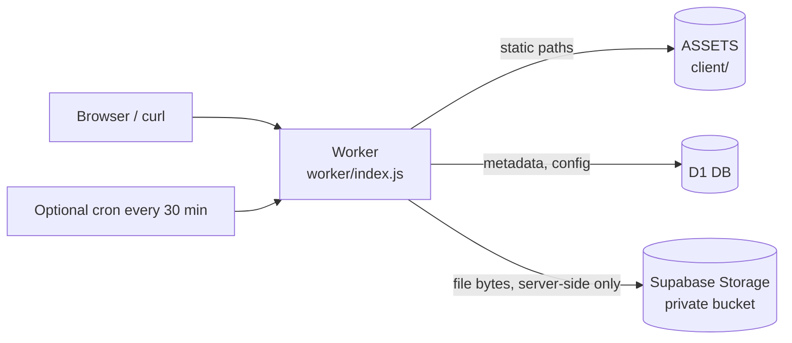
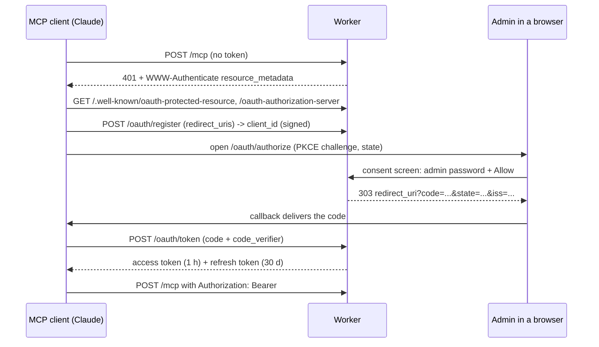

# Architecture

> Status: Final
> Last updated: 2026-11-06
> Owner: Cloud-Dark

## Components



Static files are answered by the assets layer directly. Only these paths run the Worker first
(`run_worker_first` in `wrangler.toml`): `/` (to split frontend and API host), `/api`, `/api/*`, `/file/*`, `/mcp`, `/README.md`, `/AGENT.md`, `/api.md`.

## Modules

| File | Responsibility |
|------|----------------|
| `worker/index.js` | Routing, error mapping, CORS, owner cookie, `scheduled` handler, docs endpoints |
| `worker/storage.js` | Supabase Storage client: upload, download (streamed), bulk delete |
| `worker/mcp.js` | MCP server: JSON-RPC over `POST /mcp`, tools wrap the REST handlers |
| `worker/files.js` | Upload (multipart, text), info, verify, download, delete, list, purge |
| `worker/admin.js` | Login, logout, status, password change, runtime config |
| `worker/auth.js` | Owner cookie, signed admin session, admin password check |
| `worker/crypto.js` | AES-GCM, PBKDF2 wrap/unwrap, HMAC tokens, hashing |
| `worker/config.js` | `[vars]` defaults merged with D1 overrides, limits |
| `worker/http.js` | JSON, CORS, cookies, safe `Content-Disposition` |

## Flows

### Upload (locked)

```mermaid
sequenceDiagram
    participant C as Client
    participant W as Worker
    participant D as D1
    participant R as Supabase Storage
    C->>W: POST /api (file, password, expiration)
    W->>W: check size, extension, expiry
    W->>W: encrypt content + {name,mime} with random key; wrap key with PBKDF2(password)
    W->>D: INSERT files row (claims id, retries on collision)
    W->>R: put(id, ciphertext)
    W-->>C: id, url, downloadUrl, deleteUrl + deleteToken
```

If the Storage write fails the D1 row is removed again.

### Download (locked)

`GET /file/:id/download?password=...` (or `X-Password`) loads the row, fetches the object from Supabase Storage, unwraps the key with
the password (wrong password: `401`), decrypts content and metadata, and returns the plaintext with the real filename.
Unlocked files stream through the Worker straight from Storage.

### Expiry

Reads treat `expires_at <= now` as `404`. Physical deletion happens in two ways: after a successful upload the Worker
starts a background purge (at most once per 10 minutes per isolate, `maybePurge` in `worker/index.js`), and, if the
optional cron trigger is enabled, every 30 minutes. A purge selects up to 100 expired rows per round (max 20 rounds),
deletes the Storage objects, then the rows. With no traffic nothing new is uploaded, so expired objects can stay in
Storage until the next upload; they are never readable ([10_RISK_REGISTER.md](10_RISK_REGISTER.md) R-15).

### Identity and admin

- Every visitor receives a random `tete_uid` cookie (30 days); uploads record it as owner.
- Admin login verifies the password and sets a signed `tete_admin` cookie. No server-side session storage exists.

## Web UI

One page (`client/index.html`) with four sections: upload (hero), my files, API & MCP, and an admin section that appears after
login. The share page `/file/:id` is `client/file-view.html`. Visual language follows apipedia.id: warm paper background,
Fraunces serif headlines with an italic green keyword and an amber underline, Geist body text, deep-green pill buttons,
rounded cards with soft shadows, mint accents. Tokens are HSL CSS variables in `client/css/style.css`; the theme is set
before first paint from `localStorage` or `prefers-color-scheme`.

Behaviour worth knowing: uploads use `XMLHttpRequest` so the button shows real progress; every file name is HTML-escaped;
the admin limits form refuses to submit until the current values are loaded; locked files are downloaded with `fetch` and an
`X-Password` header so a wrong password produces a message instead of a saved error file.

## Roles and the admin dashboard

| | Public | Admin (cookie or OAuth) |
|---|--------|-------------------------|
| Largest file | 25 MB | no limit from TETE for files without a password (streamed via `POST /api/admin/upload`); 25 MB with a password |
| Lifetime | up to 7 days | any, including Never |
| Storage quota | counted | not counted |
| Sees | own files | every file |

`/admin` (`client/admin.html`, `client/js/admin.js`) is a separate page with its own sign-in card: overview KPIs from
`GET /api/admin/stats`, a Supabase panel from `GET /api/admin/storage` (real bucket usage, remaining against the configured quota),
the file table (client-side search, filter and sort over the newest 200, bulk delete), limits and security. The main page, when
an admin is signed in, shows the Never chip and uploads files without a password through the streaming endpoint.

## OAuth for MCP



Design notes: tokens are stateless HMAC-signed values (purpose-bound keys derived from `SESSION_SECRET`); the only stored state
is `oauth_codes` (single-use codes) and `oauthEpoch` in `config` (bump to sign out every client). Dynamic registration is open by
design (the protocol requires it for connectors), so the consent screen with the admin password is the real gate.
`/mcp/public` is a separate anonymous endpoint because an OAuth-protected `/mcp` must answer `401` to unauthenticated clients.

## MCP access levels

| Endpoint | Caller | Tools |
|----------|--------|-------|
| `/mcp/public` | Anyone | `upload_text`, `upload_base64`, `file_info`, `read_text`, `delete_file` (needs the per-file token) |
| `/mcp` | OAuth access token, or the static `MCP_TOKEN` | the above, plus `list_files`, `get_config`, `update_config`, `purge_expired`; `delete_file` without a per-file token |

## Two hostnames

| Host | Role |
|------|------|
| `tete.apipedia.id` | Frontend: web UI, share page `/file/:id`. The UI calls the API on the same origin so cookies work |
| `tetein.apipedia.id` | API host: `/api`, `/mcp`, `/file/:id/download`, delete, docs. Its `/` returns the API index; a browser opening `/file/:id` is redirected (302) to the frontend |

Both are custom domains of the same Worker. `worker/links.js` builds links: `url` on the frontend host, `downloadUrl` and
`deleteUrl` on the API host, but only when the request arrives on one of the two configured hosts (`FRONTEND_HOST`,
`API_HOST`); on workers.dev or local dev every link uses the request's own origin.

## Why Supabase stays invisible

Browsers, `curl` users and MCP clients only talk to the Worker. The Worker calls Supabase Storage server-side with the
service-role key, so share links are always `https://tete.apipedia.id/file/<id>` and the Supabase hostname and key never
leave the Worker. The cost is one extra network hop on every upload and download.

## Browser vs API on `/file/:id`

A request that looks like a browser navigation (`Sec-Fetch-Dest: document`, or `Accept` naming `text/html`) receives
`client/file-view.html`; anything else (curl, `fetch`) receives JSON. The page itself loads data from `/api/file/:id`.

Decisions behind this design: [11_DECISIONS.md](11_DECISIONS.md). Schema: [20_DATABASE.md](20_DATABASE.md).
