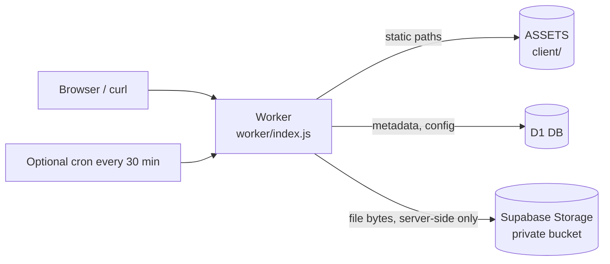

# Architecture

> Status: Final
> Last updated: 2026-11-06
> Owner: Cloud-Dark

## Components



Static files are answered by the assets layer directly. Only these paths run the Worker first
(`run_worker_first` in `wrangler.toml`): `/api`, `/api/*`, `/file/*`, `/mcp`, `/README.md`, `/AGENT.md`, `/api.md`.

## Modules

| File | Responsibility |
|------|----------------|
| `worker/index.js` | Routing, error mapping, CORS, owner cookie, `scheduled` handler, docs endpoints |
| `worker/storage.js` | Supabase Storage client: upload, download (streamed), bulk delete |
| `worker/mcp.js` | MCP server: JSON-RPC over `POST /mcp`, tools wrap the REST handlers |
| `worker/files.js` | Upload (multipart, text), info, verify, download, delete, list, purge |
| `worker/admin.js` | Login, logout, status, password change, runtime config |
| `worker/auth.js` | Owner cookie, signed admin session, admin password check |
| `worker/crypto.js` | AES-GCM, PBKDF2 wrap/unwrap, HMAC tokens, hashing |
| `worker/config.js` | `[vars]` defaults merged with D1 overrides, limits |
| `worker/http.js` | JSON, CORS, cookies, safe `Content-Disposition` |

## Flows

### Upload (locked)

```mermaid
sequenceDiagram
    participant C as Client
    participant W as Worker
    participant D as D1
    participant R as Supabase Storage
    C->>W: POST /api (file, password, expiration)
    W->>W: check size, extension, expiry
    W->>W: encrypt content + {name,mime} with random key; wrap key with PBKDF2(password)
    W->>D: INSERT files row (claims id, retries on collision)
    W->>R: put(id, ciphertext)
    W-->>C: id, url, downloadUrl, deleteUrl + deleteToken
```

If the Storage write fails the D1 row is removed again.

### Download (locked)

`GET /file/:id/download?password=...` (or `X-Password`) loads the row, fetches the object from Supabase Storage, unwraps the key with
the password (wrong password: `401`), decrypts content and metadata, and returns the plaintext with the real filename.
Unlocked files stream through the Worker straight from Storage.

### Expiry

Reads treat `expires_at <= now` as `404`. Physical deletion happens in two ways: after a successful upload the Worker
starts a background purge (at most once per 10 minutes per isolate, `maybePurge` in `worker/index.js`), and, if the
optional cron trigger is enabled, every 30 minutes. A purge selects up to 100 expired rows per round (max 20 rounds),
deletes the Storage objects, then the rows. With no traffic nothing new is uploaded, so expired objects can stay in
Storage until the next upload; they are never readable ([10_RISK_REGISTER.md](10_RISK_REGISTER.md) R-15).

### Identity and admin

- Every visitor receives a random `tete_uid` cookie (30 days); uploads record it as owner.
- Admin login verifies the password and sets a signed `tete_admin` cookie. No server-side session storage exists.

## Why Supabase stays invisible

Browsers, `curl` users and MCP clients only talk to the Worker. The Worker calls Supabase Storage server-side with the
service-role key, so share links are always `https://tete.apipedia.id/file/<id>` and the Supabase hostname and key never
leave the Worker. The cost is one extra network hop on every upload and download.

## Browser vs API on `/file/:id`

A request that looks like a browser navigation (`Sec-Fetch-Dest: document`, or `Accept` naming `text/html`) receives
`client/file-view.html`; anything else (curl, `fetch`) receives JSON. The page itself loads data from `/api/file/:id`.

Decisions behind this design: [11_DECISIONS.md](11_DECISIONS.md). Schema: [20_DATABASE.md](20_DATABASE.md).
